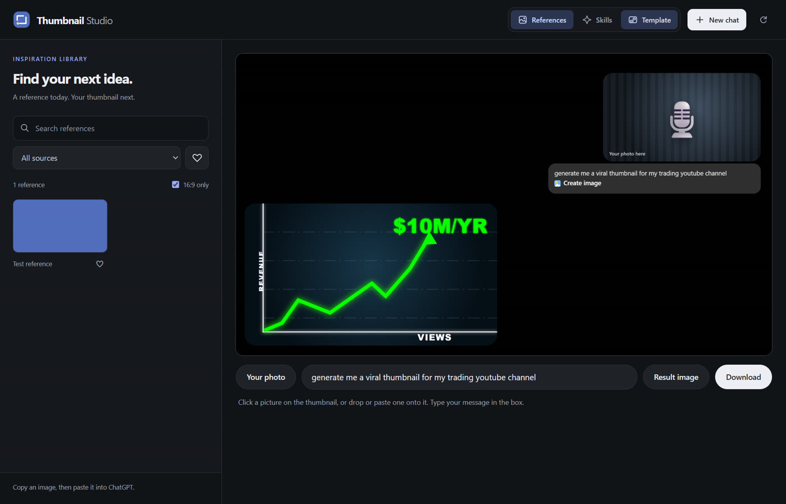
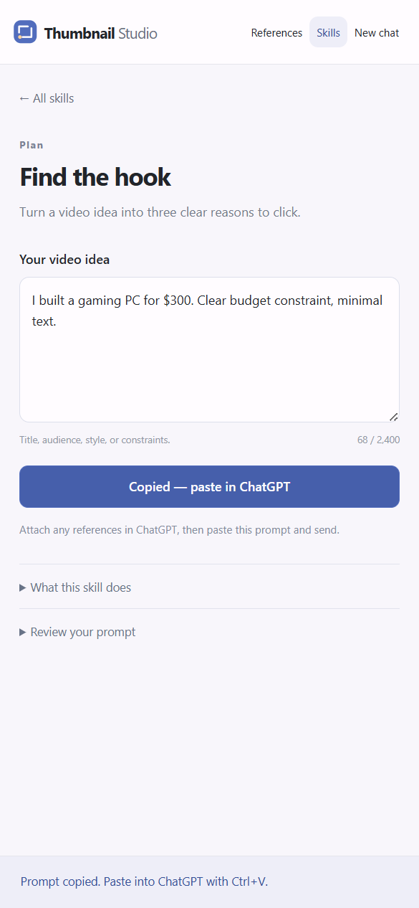

<p align="center"></p>

<h1 align="center">Thumbnail Studio</h1>

<p align="center">Your references. A better brief. ChatGPT beside you.</p>

A minimal Windows workspace for designing YouTube thumbnails: the real ChatGPT website in a native browser view, an optional local reference library, **12 built-in thumbnail-design skills**, and a one-click **Template** for "I asked ChatGPT for a thumbnail" style videos.

<p align="center"></p>

## Start creating

Requires **Windows**, **Node.js 24+**, and **Git**. The desktop app needs no API key or Python server.

```powershell
git clone https://github.com/blixvip/thumbnail-studio.git
cd thumbnail-studio
npm ci
npm run install:electron
npm run desktop
```

After setup, double-click **Start Thumbnail Studio.vbs** to launch without a terminal. Sign in to ChatGPT inside the app; its image-generation features and usage limits depend on your account. Thumbnail Studio is an independent app, not an OpenAI product.

For a desktop shortcut, run `powershell -ExecutionPolicy Bypass -File scripts/install-shortcut.ps1`.

1. Open **Skills** and pick a workflow, such as **Find the hook** or **Remix a reference**.
2. Describe your video, audience, and constraints. Click **Copy prompt**.
3. Paste it into ChatGPT and send. For visual references, copy an image from **References** and paste it into ChatGPT first.

## Three tabs

| Tab | What it's for |
| --- | --- |
| **References** | Your inspiration library: search, filter, favorite, and copy an image to paste into ChatGPT (or into the Template). |
| **Skills** | Twelve focused design workflows that turn your video idea into a ready-to-paste ChatGPT prompt. |
| **Template** | A finished 1920×1080 thumbnail: your photo, your chat message, and the result image, ready to download. |

References and Skills share one collapsible side panel. **New chat** starts a fresh conversation. ChatGPT handles image generation and downloads through its normal controls.

## Make a thumbnail with the Template

The Template recreates the "I asked ChatGPT" look on black: your photo at the top right, your message in a chat bubble under it, and the generated result at the bottom left.

1. Click **Template**. It takes the place of ChatGPT until you click it again.
2. Click the top-right picture to add **your photo**. You can also drop an image on it, or paste one (for example, a reference you copied).
3. Type **your message**. The bubble grows with it, and long lines and words wrap.
4. Add the **result image** at the bottom left.
5. Click **Download**. The thumbnail saves straight to your Downloads folder, named after your message, and never overwrites an existing file. It's a PNG, or a high-quality JPG if the PNG would be over YouTube's 2 MB limit.

## Twelve ways to improve a thumbnail

| Plan              | Design                  | Explore & refine         |
| ----------------- | ----------------------- | ------------------------ |
| Find the hook     | Build the composition   | Explore three directions |
| Remix a reference | Write thumbnail text    | Check the small version  |
|                   | Fix color & contrast    | Give it a final pass     |
|                   | Direct the expression   |                          |
|                   | Spotlight a product     |                          |
|                   | Show the transformation |                          |
|                   | Design without a face   |                          |

Every skill is a readable, editable Markdown workflow in [`skills/`](skills/). [See how design skills work](docs/DESIGN-SKILLS.md).

<details><summary>Preview the design workflow</summary>
<p></p>
</details>

## Bring your reference library

Search imported images, filter by source, save favorites, and copy references with one click. A fresh checkout starts with an empty library; the application does not include third-party portfolio images. The skills work immediately without imports.

The optional importer requires Python 3.11+, Pillow, and Google Chrome. [Import and refresh references](docs/REFERENCE-LIBRARY.md).

## Local data and sign-in

- ChatGPT sign-in stays in a separate app profile at `%APPDATA%\Thumbnail`. This existing folder name is preserved so an app rename does not reset your session.
- Favorites and the current video brief are stored locally. Template images stay in memory until you download, and nothing is uploaded. Reference files live in `data/`, outside Git.
- ChatGPT is sandboxed with no Node.js or reference-bridge access. Microphone, camera, and other browser permissions are disabled in this minimal version.
- Copying a reference or prompt changes the clipboard. It does **not** submit a message or automatically upload files.
- ChatGPT handles its own authentication and may request verification. Your regular browser's cookies are not copied into the app.
- The app requests a 100 MB browser disk-cache limit; this does not cap downloaded images, imported references, or all profile storage.

To reuse an existing compatible Electron runtime, set `THUMBNAIL_ELECTRON` to its absolute executable path and skip `install:electron`. The optional `.desktop-runtime.json` local file can also point to an existing runtime; it is excluded from Git. `npm ci` installs dependencies; `npm run install:electron` downloads the pinned desktop runtime.

## Verification

```powershell
python -m pip install -r requirements.txt
npm test
npm run test:desktop
npm run verify:desktop
node scripts/verify-template.mjs <photo> <result>
npm audit
```

The Python tests cover the importer. Node tests cover navigation restrictions, media paths, responsive layout bounds, and design-prompt validation. Electron checks use synthetic reference images, a disposable profile, and a local chat stand-in; they verify layout, copying, favorites, filtering, failure recovery, design skills, and brief persistence. They do not send ChatGPT messages or alter the OS clipboard. `verify-template.mjs` opens the Template in the real app, fills both photos and several messages (including one very long word), downloads, and checks that the file is saved and ChatGPT returns afterwards.

`node scripts/verify-chatgpt.mjs` separately checks the real page stays visible after background loading and same-document navigation, and accepts keyboard edits. It uses a disposable profile and submits no credentials or messages. A human-verification challenge blocks this check; successful authentication and image generation are not covered.

Brand assets and interface guidance are in [`docs/brand/`](docs/brand/). No project-wide redistribution license has been assigned.
